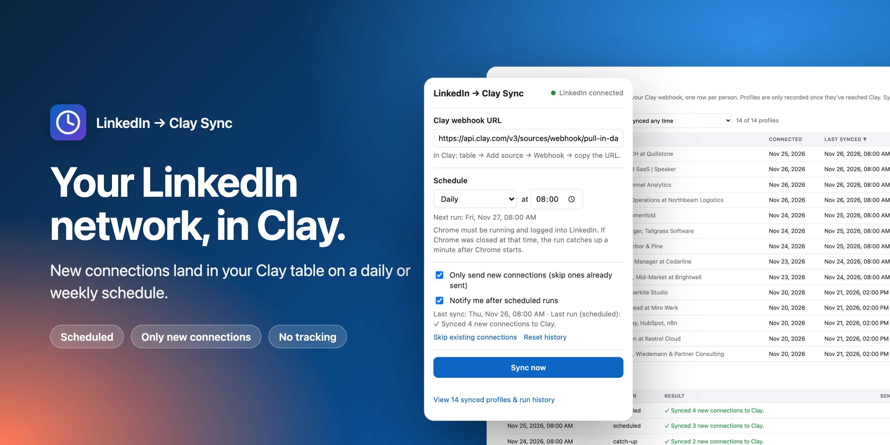
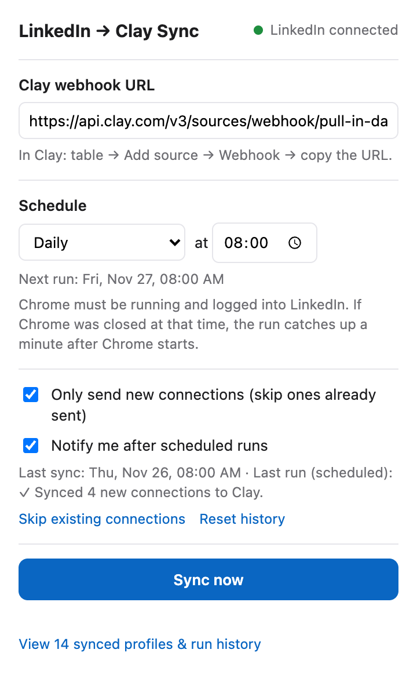
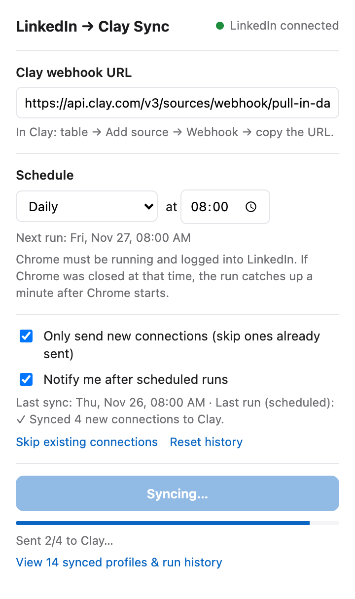
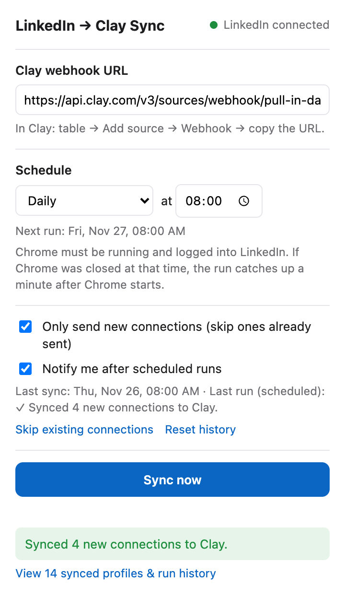
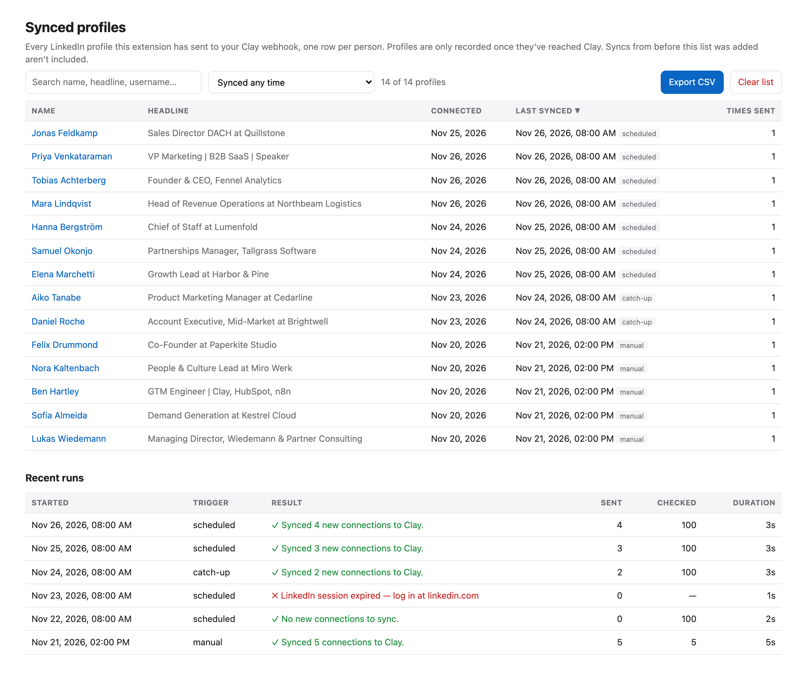

<p align="center">
  
</p>

<h1 align="center">LinkedIn → Clay Sync</h1>

<p align="center">
  A Chrome extension that sends your LinkedIn connections to a Clay table,<br>
  by hand or on a daily or weekly schedule.
</p>

<p align="center">
  
  
  
  
  
</p>

<p align="center">
  <a href="#install">Install</a> ·
  <a href="#set-up">Set up</a> ·
  <a href="#what-it-does">What it does</a> ·
  <a href="#what-clay-receives">What Clay receives</a> ·
  <a href="#privacy">Privacy</a> ·
  <a href="#before-you-use-it">Before you use it</a>
</p>

---

Every person you connect with on LinkedIn becomes a row in Clay, where you can enrich, score and route them. The extension reads your connections with the LinkedIn session you already have in Chrome and posts each one to a Clay webhook that you own. There is no server in between and no account to create.

## Install

1. Download `linkedin-clay-sync-v3.1.0.zip` from the [latest release](../../releases/latest) and unzip it.
2. Open `chrome://extensions` and turn on **Developer mode** (top right).
3. Click **Load unpacked** and pick the unzipped `linkedin-clay-sync` folder.
4. Pin the extension to the toolbar.

If you have the original "LinkedIn → Clay Sync" from the Chrome Web Store installed, remove it first so the two don't both send to your table.

Chrome loads the extension from that folder each time it starts, so keep the folder where it is. It works the same way in Edge, Brave and Arc.

## Set up



1. **Create the webhook in Clay.** Open your table, choose **Add source → Webhook** and copy the URL.
2. **Paste it into the extension.** Click the toolbar icon and paste the URL into **Clay webhook URL**. The dot at the top turns green when Chrome is logged into LinkedIn.
3. **Decide who gets sent the first time.** The first sync sends all of your connections. If your Clay table already has them, click **Skip existing connections** first. From then on only people you connect with later are sent.
4. **Pick a schedule.** Off, daily or weekly, at a time you choose. Or click **Sync now** whenever you want a run.

You can close the popup while a sync runs. It keeps going in the background.

<br clear="right">

## What it does

| | |
|---|---|
| **Sync now** | Runs right away and shows progress in the popup. |
| **Daily or weekly schedule** | Runs at the time you set. Chrome has to be open and logged into LinkedIn. |
| **Catch-up runs** | If Chrome was closed at the scheduled time, the missed run starts about a minute after Chrome opens. |
| **Only new connections** | On by default. Sends the people you've connected with since the last successful sync. |
| **Few LinkedIn requests** | It asks for the newest connections first and stops when it reaches ones it already sent. A daily run usually needs one request. |
| **No duplicates after a failed run** | People already sent are remembered, so a retry continues where the failed run stopped. |
| **Retries** | Waits and tries again when LinkedIn or Clay answer with a rate limit or a server error (HTTP 429 or 5xx). |
| **Notifications** | After a scheduled run that sent someone or failed. You can turn them off. |
| **Synced profiles page** | Every profile sent to Clay, with search, time filter, sorting and CSV export. |
| **Run history** | The last 20 runs with trigger, result, how many were sent and how long it took. |

<p align="center">
  
  &nbsp;&nbsp;&nbsp;
  
</p>

### Synced profiles and run history

The link at the bottom of the popup opens a page that lists every profile the extension has sent to Clay: name (linked to the profile), headline, connection date, when it was last synced, by which kind of run, and how often it has been sent.

You can search, filter by time (including "in the latest sync that sent anyone"), sort by any column and export a CSV. **Clear list** only empties this list. It doesn't change what gets synced next.

<p align="center">
  
</p>

<p align="center"><sub>The screenshots show invented demo profiles.</sub></p>

### Starting over

- **Skip existing connections** marks everyone you're connected with right now as already synced.
- **Reset history** forgets what was sent. The next sync sends everyone again.

## What Clay receives

One POST per connection, oldest first, with this JSON body:

```json
{
  "firstName": "Mara",
  "lastName": "Lindqvist",
  "fullName": "Mara Lindqvist",
  "headline": "Head of Revenue Operations at Northbeam Logistics",
  "profileUrl": "https://www.linkedin.com/in/mara-lindqvist-demo",
  "publicIdentifier": "mara-lindqvist-demo",
  "connectedAt": "2026-11-26T04:12:00.000Z",
  "entityUrn": "urn:li:fsd_profile:…"
}
```

`connectedAt` is the moment you connected, as an ISO timestamp. `entityUrn` is LinkedIn's ID for the profile and stays the same when someone changes their profile URL, so it's the best column to de-duplicate on in Clay.

## Privacy

- The extension talks to two places: `linkedin.com`, to read your connections, and the webhook URL you entered, to write them. Nothing else.
- No analytics, no usage events, no remote code.
- Your settings, the list of synced profiles and the run history are stored in your browser (Chrome storage and IndexedDB). Removing the extension deletes them.
- It reads two LinkedIn cookies (`li_at`, `JSESSIONID`) to check that you're logged in and to sign its requests. They are sent to LinkedIn only.

| Permission | Why |
|---|---|
| `cookies` | Check the LinkedIn login and read the session token for the request header |
| `storage`, `unlimitedStorage` | Settings, sync state and the synced profiles list |
| `alarms` | The daily or weekly schedule |
| `notifications` | The message after a scheduled run |
| `linkedin.com`, `clay.com` | Read connections, post to your webhook |

## Before you use it

The extension reads LinkedIn's internal API with your own login session. That is against LinkedIn's terms of service, and LinkedIn can restrict accounts that do it. Keep the schedule at daily or weekly, and use it at your own risk.

It is not affiliated with LinkedIn or Clay.

## How it works

```
 Chrome alarm or "Sync now"
            │
            ▼
   background.js (service worker)
            │  1. read the LinkedIn session from Chrome's cookies
            │  2. page through connections, newest first,
            │     and stop at the last one already sent
            │  3. POST each new connection to your Clay webhook
            │  4. record it in the synced profiles list
            ▼
     your Clay table
```

| File | What it holds |
|---|---|
| `manifest.json` | Extension manifest (Manifest V3) |
| `background.js` | Schedule, LinkedIn paging, webhook posts, retries, run log |
| `db.js` | The synced profiles list in IndexedDB |
| `popup.html`, `popup.js` | The popup |
| `history.html`, `history.js` | The synced profiles and run history page |
| `scripts/package.sh` | Builds the release zip |
| `scripts/screenshots.mjs` | Regenerates the screenshots from the real extension with demo data |

Plain JavaScript, no dependencies and no build step. The files in this folder are the extension.

## Development

Load this folder with **Load unpacked**. After a change, click the reload arrow on the extension's card in `chrome://extensions`.

```bash
npm run package       # dist/linkedin-clay-sync-v<version>.zip
npm install           # once, for the screenshot script
npm run screenshots   # rewrites docs/screenshots/
```

The screenshot script loads the extension into a throwaway Chromium profile, fills it with invented profiles and takes the pictures. It doesn't start a sync and doesn't contact LinkedIn or Clay.

To release a new version, raise `version` in `manifest.json`, run `npm run package` and attach the zip to a new GitHub release.

## Troubleshooting

| You see | What to do |
|---|---|
| "Not logged into LinkedIn" | Log in at linkedin.com in the same Chrome profile, then reopen the popup. |
| "LinkedIn session expired" | Open linkedin.com, log in again and run the sync once more. |
| "Webhook error: 4xx" | Check the webhook URL in Clay and paste it again. |
| The scheduled run didn't happen | Chrome was closed at that time. The run starts about a minute after Chrome opens. |
| Rows appear twice in Clay | The old Web Store version is still installed, or the history was reset. De-duplicate on `entityUrn`. |
| **Sync now** is grey | The webhook URL has to start with `https://` and LinkedIn has to be logged in. |

## Credits and license

Based on "LinkedIn → Clay Sync" v2.0.0 by GTMBase.io (MIT). Compared with that version, this one adds:

- the daily or weekly schedule with catch-up runs and notifications,
- the synced profiles list and run history with CSV export,
- sending only new connections, with far fewer LinkedIn requests,
- retries on rate limits and no duplicates after a failed run.

It also removes the tracking: the original sent your own LinkedIn profile and usage events to its developer's Clay webhook.

[MIT](LICENSE) © 2026 Jens Polomski
